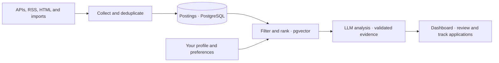

<!-- Project overview; detailed setup and design documentation lives under docs/. -->
# jagent

## Summary

A personal job-search pipeline that collects postings, ranks them against your
profile, and explains a shortlist in a local dashboard.

Built with Python, PostgreSQL and pgvector.

## Screenshot

TODO: Add an anonymized dashboard screenshot.

## Problem

The same jobs appear across multiple boards. Finding relevant roles and tracking
applications should take less time than reviewing every listing by hand.

## How it works



See the [architecture and diagrams](docs/architecture.md).

## Key design decisions

Deterministic source parsers, section-based profile matching, and one LLM analysis
step with evidence validation. [Decisions and alternatives](docs/decisions.md).

## Results

TODO: Add shortlist relevance, time saved, API costs and application outcomes.

## Setup

Requires Python 3.12+, uv, Docker and Docker Compose.

```bash
uv sync --group dev
cp .env.example .env
cp profile.example.md profile.md
cp filters.example.json filters.json
```

Edit those files with your database credentials, API settings and search profile.
Then follow the [setup guide](docs/setup.md) to start the database, run the
pipeline and open the dashboard. It also covers tests and optional deployment.

## Limitations

Source formats can change, and some sites require imports from a home connection.
Ranking and explanations need human review. Profile text and job descriptions
are sent to the configured API providers. The dashboard is intended for local access.

## Roadmap

TODO: Measure relevance and costs, add a dashboard screenshot, and review source coverage.
