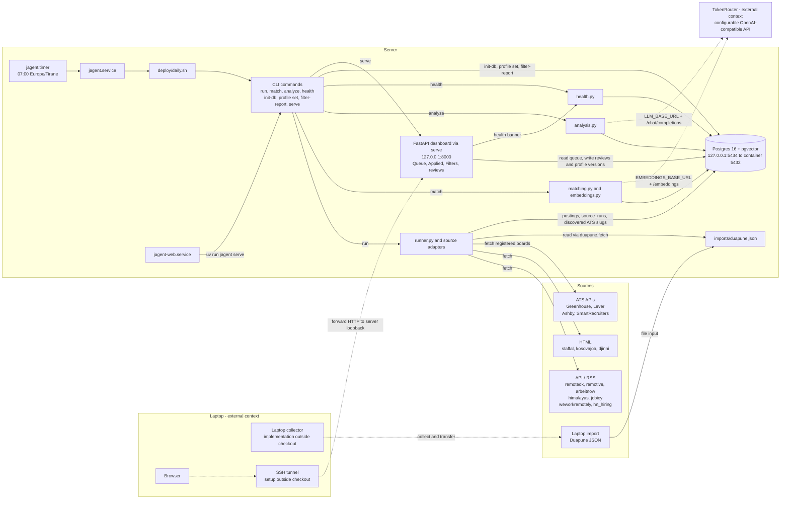
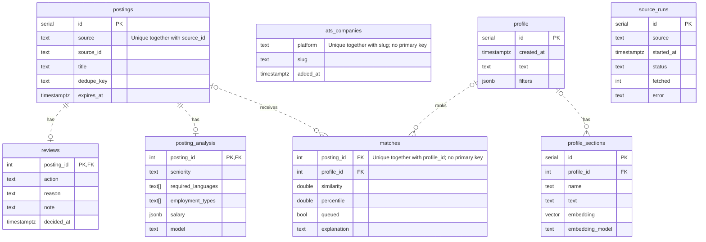
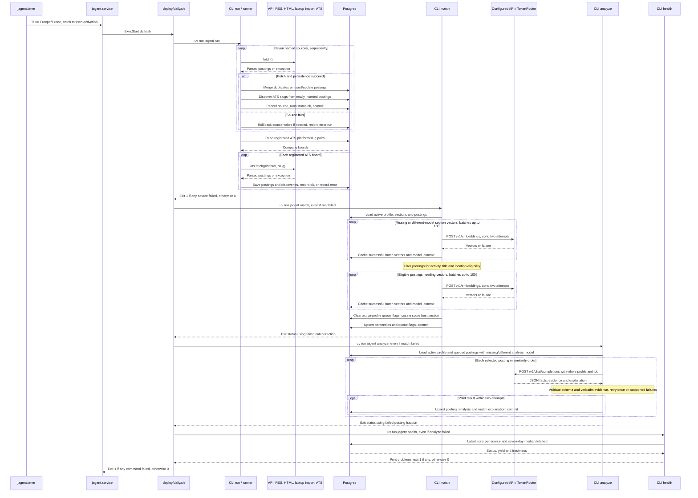
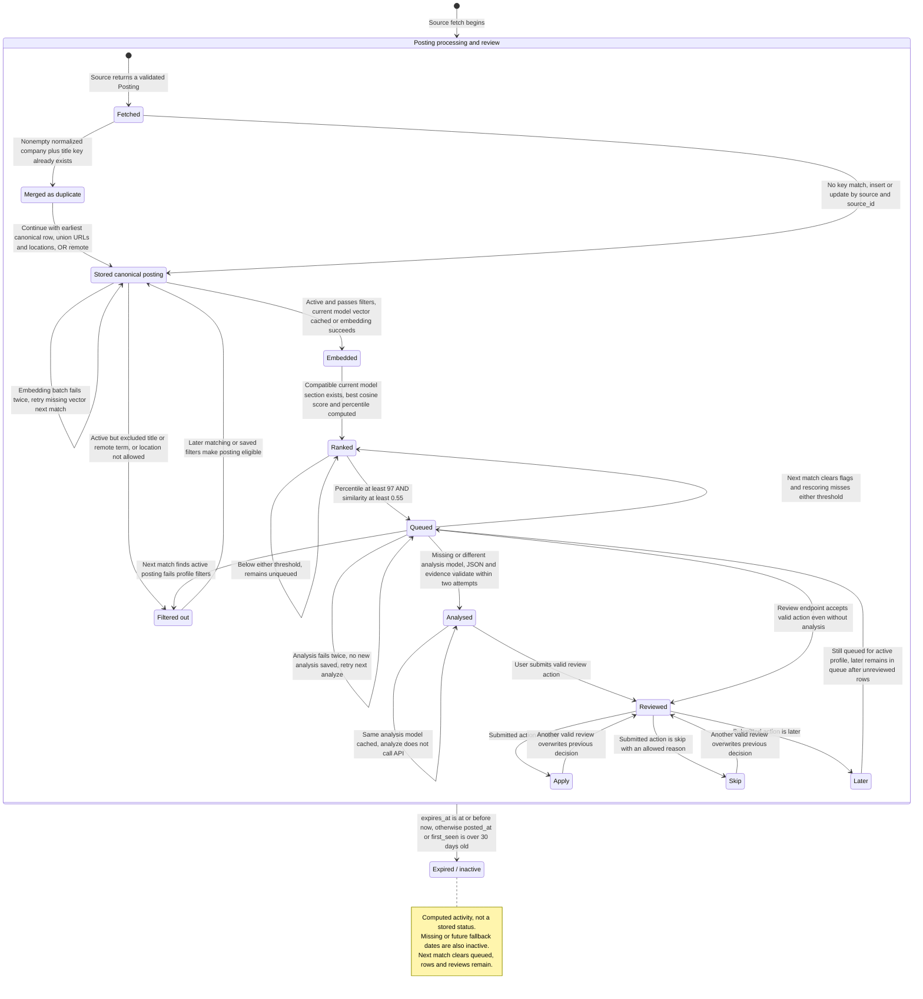

<!-- Architecture derived from source and schema; nodes name components/tables, messages name calls, and state labels describe computed posting eligibility. -->
# Architecture

Simplified PlantUML versions: [Components](components.puml),
[Database entities](database-entities.puml), [Daily run](daily-run.puml),
and [Posting lifecycle](posting-lifecycle.puml).

Built from [schema.sql](../schema.sql), the [CLI](../jagent/cli.py),
[runner](../jagent/runner.py), source adapters, matching, analysis, dashboard,
and [deployment files](../deploy/). Solid component arrows show implemented calls
or dependencies; dotted arrows show the requested external operating context.
The laptop collector, SSH tunnel setup, and TokenRouter deployment are not in
this checkout. The API clients accept configurable base URLs; `.env.example`
uses OpenAI URLs, so routing through TokenRouter is conditional on configuration.

## Components

The runner fetches eleven named sources, then boards registered in `ats_companies`; new postings can discover more ATS slugs.
Duapune reads a local JSON file and rejects missing imports, timezone-free collection times, or imports older than 36 hours.
The timer starts the daily oneshot service; the separate web service runs the dashboard continuously and restarts on failure.
Database connections force UTC; Docker publishes Postgres on loopback port 5434, and `serve` binds loopback port 8000.

## Database entities

All eight tables are shown with their keys and three to five selected non-key columns; the small `ats_companies` table has only three columns total.
`matches` and `ats_companies` have composite UNIQUE constraints, not primary keys; `postings` also uniquely identifies `(source, source_id)`.
Nullable foreign keys use optional parent cardinality; analysis and reviews share the posting ID as their primary and foreign key.
`source_runs.source` and `ats_companies` have no foreign-key relationship to postings; the greatest `profile.id` is the active version.

## Daily run

`daily.sh` logs each command in UTC and attempts all four commands even when an earlier command fails.
Each source is isolated; a failed source records an error run while later sources continue, including registered ATS boards.
Matching reuses vectors by model, scores the best compatible profile section, and queues similarity ≥ 0.55 with percentile ≥ 97.
Analysis reuses results by model; matching and analysis fail the CLI when all attempts fail or failures exceed 10%, while health flags source errors, stale non-ATS runs, and low full-feed yield.
The API participant uses the configured base URLs; health exempts incremental Himalayas/Djinni from yield checks and aggregates ATS board errors.

## Posting lifecycle

These are logical stages across `postings`, `matches`, `posting_analysis`, and `reviews`; duplicate merging retains the earliest canonical posting rather than creating another row.
Filters reject excluded terms, then accept remote postings without locations or require allowed countries/remote regions; activity uses the explicit deadline before the 30-day fallback.
Ranking uses the recent 30-day scored cohort for percentiles; failed embedding/analysis work can retry on later runs, and existing vectors/results are reused by model.
Reviews require no analysis; apply moves to Applied, skip requires a reason and leaves the queue, and later stays queued subject to dashboard view filters (seniority, languages, contract).
Expiry is evaluated during filtering, not by a background state transition; the dashboard relies on stored queue flags, and Applied retains reviews even after expiry.
